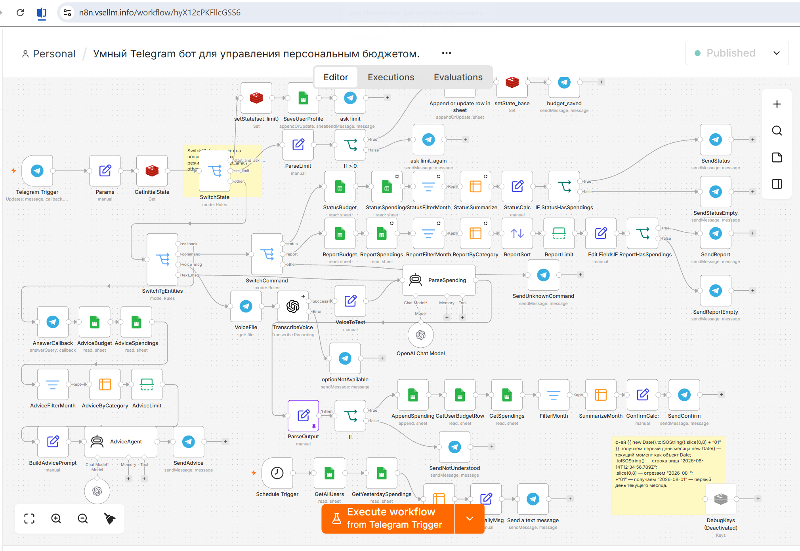

# AI Budget Agent (n8n + OpenAI + Telegram)

Продвинутый асинхронный ИИ-агент для автоматизации персонального финансового учета в Telegram.

## Архитектура системы

## Технический стек и особенности
* **Платформа автоматизации:** n8n (Self-hosted / Cloud)
* **Ядро ИИ:** OpenAI Chat Model (GPT) для извлечения сущностей, категорий и суммы трат из неструктурированного текста.
* **Интерфейсы:** Telegram Bot API с поддержкой голосовых сообщений (интеграция Whisper Voice-to-Text).
* **Бизнес-логика:** Кастомные JavaScript-ноды для парсинга дат, распределения лимитов и калькуляции КБЖУ/финансов. Многоуровневое управление состояниями (SwitchState).

## Как запустить проект
1. Скачайте файл `smart-budget-bot.json` из этого репозитория.
2. В вашем интерфейсе n8n нажмите `Add workflow` -> `Import from file` и выберите скачанный JSON.
3. Настройте ваши API-ключи (Credentials) для Telegram Bot и OpenAI в соответствующих нодах.
